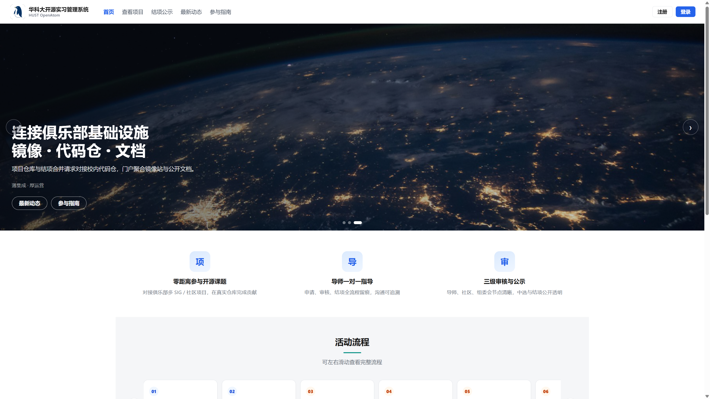
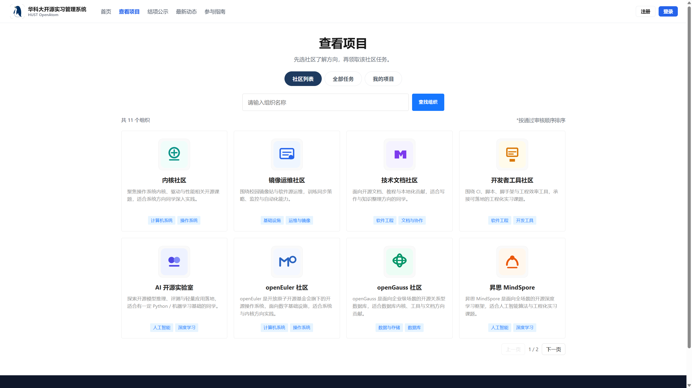
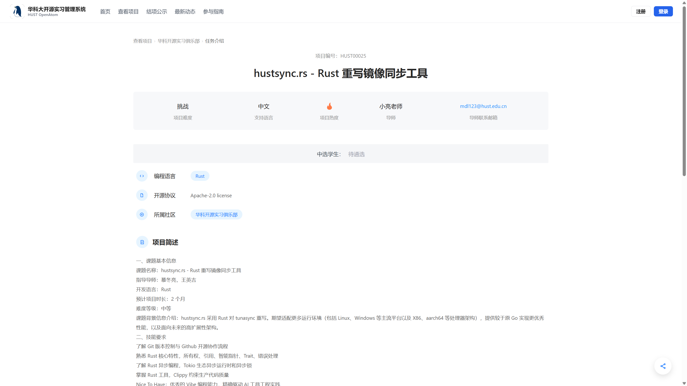
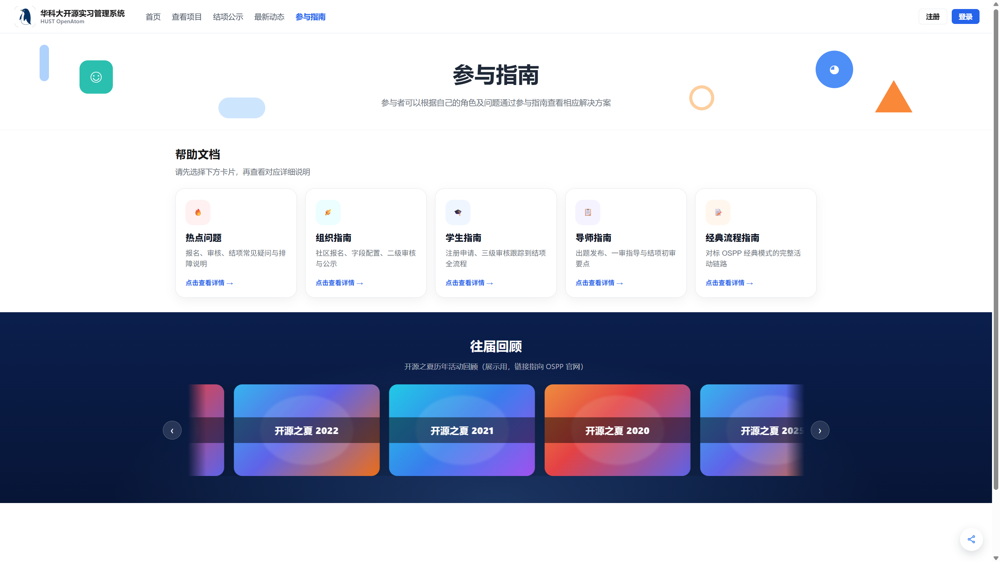
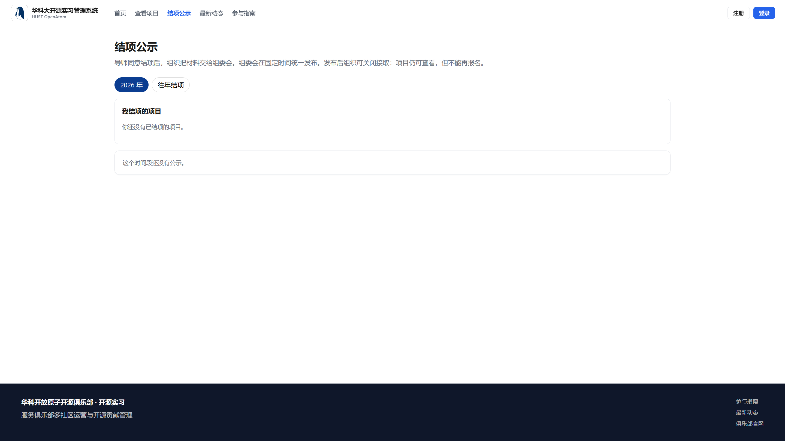
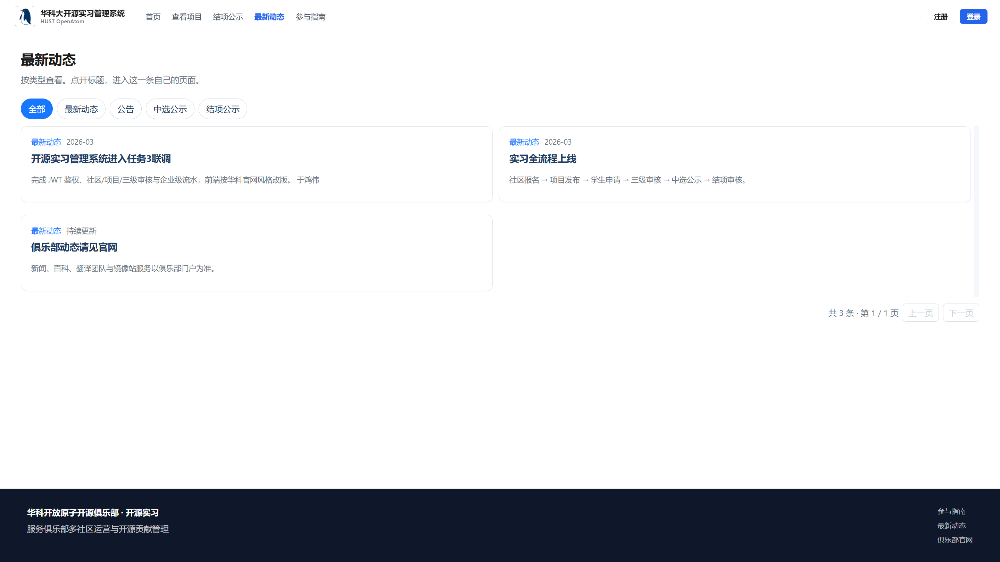
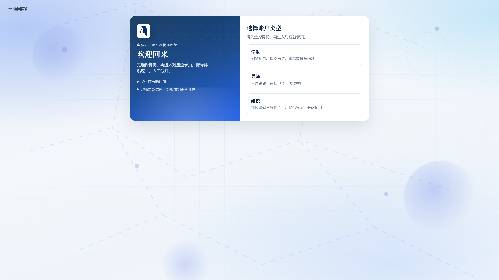

# 公开浏览 · 操作手册

## 适用对象

未登录的**访客**：了解活动、浏览社区与课题、查看结项公示与平台动态。

## 入口地址

- 首页：https://intern.openatom.club/
- 查看项目：https://intern.openatom.club/projects
- 结项公示：https://intern.openatom.club/completed
- 最新动态：https://intern.openatom.club/news
- 参与指南：https://intern.openatom.club/guide
- 登录（需操作时）：https://intern.openatom.club/login

## 前置条件

无。全部公开页均可直接访问。若要「申请接取」课题，需先 [注册/登录学生账号](./01-学生端操作手册.md)。

---

## 全流程概览（访客视角）

1. 在首页了解活动与俱乐部服务入口。  
2. 在「查看项目」中按社区或课题筛选，进入任务详情阅读 Markdown 任务书。  
3. 阅读「参与指南」中按角色划分的说明。  
4. 关注「结项公示」「最新动态」获取公示与公告。  
5. 决定参与后，右上角 **注册** 或 **登录**（学生身份）。

---

## 1. 浏览首页

1. 打开 https://intern.openatom.club/ 。  
2. 顶部导航可进入：**首页**、**查看项目**、**结项公示**、**最新动态**、**参与指南**。  
3. 右上角 **注册**、**登录** 用于进入业务操作（登录页再选学生 / 导师 / 组织）。  
4. 中部轮播与下方流程卡片介绍从报名到结项的全链路。

**预期结果**：能看到导航、轮播与活动流程说明，无需登录。

---

## 2. 查看项目列表

1. 点击导航 **查看项目**，或访问 `/projects` 。  
2. 页内三个子 Tab（默认「社区列表」）：  
   - **社区列表**：浏览各开源社区简介，点击进入社区主页。  
   - **全部任务**：按方向、难度等筛选已发布课题。  
   - **我的项目**：需登录；未登录时引导登录。  
3. 在「全部任务」中点击课题卡片上的 **查看**，进入任务详情。

**预期结果**：能看到社区卡片或任务列表；筛选条件变更后列表刷新。

---

## 3. 阅读项目（任务）详情

1. 在任务详情页查看：项目编号、难度、导师与联系邮箱、技术栈、开源协议、所属社区。  
2. 阅读 **项目简述**（正文支持 **Markdown** 排版，由组织在后台编写）。  
3. 未登录时点击 **申请接取** 会跳转到登录页（学生身份）。  
4. 已登录学生若名额已满或任务未开放，按钮会提示不可申请。

**预期结果**：任务书内容格式化展示；可申请时学生可进入申请书填写页。

---

## 4. 参与指南

1. 打开 **参与指南**（`/guide`）。  
2. 选择 **热点问题**、**活动流程**、**学生指南**、**导师指南** 等分区，左侧目录跳转到对应章节。  
3. 指南内容与平台规则一致，可作为各角色手册的补充阅读。

**预期结果**：能按角色或主题查阅说明，无需登录。

---

## 5. 结项公示

1. 打开 **结项公示**（`/completed`）。  
2. 按年份或列表浏览组委会已发布的结项结果（数据来自社区审核通过后的汇总流程）。  
3. 点击条目可查看公示详情（以页面实际展示为准）。

**预期结果**：看到已公示的结项名单；无数据时页面会提示暂无。

---

## 6. 最新动态

1. 打开 **最新动态**（`/news`）。  
2. 浏览组委会或平台发布的公告、中选/结项相关动态。  
3. 点击标题进入单篇正文。

**预期结果**：动态列表按时间展示；可阅读全文。

---

## 7. 准备登录（选身份）

1. 点击右上角 **登录**，进入 https://intern.openatom.club/login 。  
2. 先 **选择账户类型**：**学生**、**导师**、**组织**（三选一）。  
3. 填写邮箱与密码登录。  
   - 学生：可先 **注册**。  
   - 导师：需 **邀请码注册**（码由社区管理员发放）。  
   - 组织：账号由 **组委会开通**，不能自助注册。  
4. **组委会**不在此页选择，入口为 https://intern.openatom.club/ops/login（公开导航不展示）。

**预期结果**：选对身份后进入对应工作台或个人中心。选错身份可点「← 重新选择账户类型」。

---

## 操作清单（访客）

- [ ] 浏览首页与活动流程  
- [ ] 在「全部任务」中筛选并打开至少一个课题详情  
- [ ] 阅读参与指南中与己相关的章节  
- [ ] 按需查看结项公示与最新动态  
- [ ] 参与前完成学生注册或向社区/组委会获取对应账号  

---

## 常见问题

**Q：为什么看不到「申请接取」或按钮灰色？**  
A：可能未登录、名额已满、任务已下架，或当前账号不是学生身份。

**Q：项目详情 Markdown 显示异常？**  
A：尝试强制刷新（Ctrl+F5）。内容以组织「发布/重新发布」后的版本为准。

**Q：组委会在哪里登录？**  
A：仅 https://intern.openatom.club/ops/login ，不在公开登录页的身份列表中。

**Q：演示环境账号？**  
A：见仓库 `docs/测试账号.md`，仅用于本地/演示。
