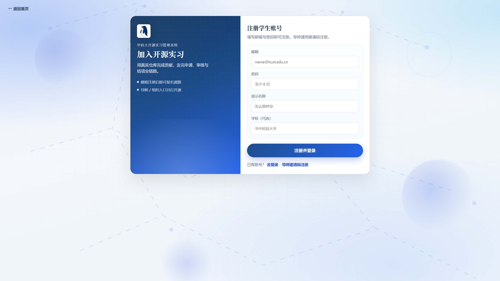
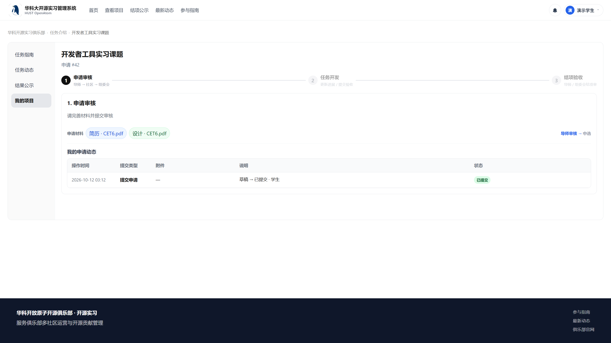
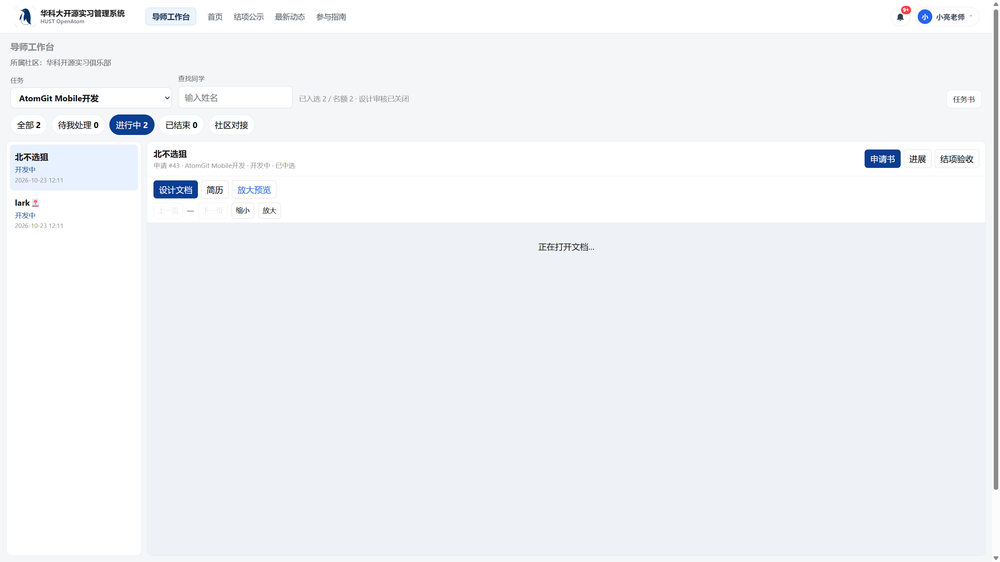

# 学生端 · 操作手册（从接任务到结项）

> 站点：https://intern.openatom.club  
> 写法参考俱乐部既有手册（如 [pwn.hust.college 学生指南](https://github.com/hust-open-atom-club/pwn.hust.college/blob/hustsec_dev/docs/User_Manual_For_Students.md)）与站内 [参与指南](https://intern.openatom.club/guide)：**按顺序点哪里、看到什么、下一步做什么**，并配截图。

---

## 你会走完的一条路

```text
注册/登录
  → 完善个人资料
  → 在「全部任务」选课题并打开详情
  → 填写真实姓名 + 上传简历/设计 PDF → 提交申请
  → 等导师审核（通过后即可开发）
  → 多次「更新进展」
  → 「提交验收」等导师结项通过
  → 「申请实习」把 ZIP 交给所属社区
  → 社区通过后进入结项名单/公示
```

**重要规则（先记住）**

1. **同时只能有一个未结束的任务**（审核中、开发中、结项审核中都算）。  
2. 报名时必须填 **真实姓名**（导师看到的是真名，不是网名）。  
3. 实习材料 ZIP 交给 **项目所属社区**，不是组委会。  
4. 结项核验常要求：**Git 提交邮箱** 与平台资料邮箱一致。

---

## 第 0 步：准备材料

开始前请准备好：

| 材料 | 格式 | 何时用 |
| --- | --- | --- |
| 个人简历 | PDF，建议 ≤ 8MB | 申请课题 |
| 项目设计 / 申请书 | PDF（可先下站内「项目申请书示例」） | 申请课题 |
| 进展交付件 | ZIP | 更新进展 |
| 结项交付件 | ZIP（含报告、PR 说明等） | 提交验收 |
| 实习认定包 | ZIP（任务书 + PR/Issue 等） | 申请实习 |

可选：学校邮箱、已能访问的代码托管账号（GitHub / 校内 GitLab 等）。

---

## 第 1 步：注册学生账号

1. 打开 https://intern.openatom.club/register 。  
2. 填写 **邮箱**、**密码**（至少 6 位）、**显示名称**、学校（可选）。  
3. 点击 **注册并登录**。



**你应该看到**：自动进入个人中心 `/me`，左侧有「概览 / 通知 / 个人资料 / 我的项目 / 修改密码」。

---

## 第 2 步：登录（已有账号）

1. 打开 https://intern.openatom.club/login 。  
2. 选择账户类型 **学生**（不要选导师/组织）。  
3. 输入邮箱、密码，点 **登录**。


**你应该看到**：进入 `/me`，或回到登录前正在看的课题页。

> 若点错成导师/组织：退出后，在登录页点「← 重新选择账户类型」，再选学生。

---

## 第 3 步：先完善个人资料（建议）

导师审核时会看到你的资料。建议第一次登录就补全。

1. 右上角点头像，或直接打开 https://intern.openatom.club/me 。  
2. 左侧点 **个人资料**。  
3. 填写学校、专业、简介、联系方式、代码托管 ID 等，保存。


**你应该看到**：概览里资料完整度上升；之后申请更容易被导师看懂「你是谁」。

---

## 第 4 步：找课题（查看全部项目）

1. 顶部点 **查看全部项目**，或打开：  
   https://intern.openatom.club/projects?tab=tasks  
2. 确认 Tab 在 **全部任务**（默认就是它）。  
3. 可用搜索、难度、方向筛选；需要按组织逛时再切到 **社区列表**。  
4. 点课题标题或「查看」进入详情。


**你应该看到**：表格列出可申请课题、社区、难度、名额；登录后还可进「我的项目」Tab。

---

## 第 5 步：读任务书，决定是否接取

1. 在详情页认真读：摘要、Markdown 任务说明、技术栈、仓库、导师、名额。  
2. 确认自己**没有**其他进行中的任务，且名额未满。  
3. 点 **申请接取**。  
   - 未登录会先跳到学生登录，登完会回到这里。


**你应该看到**：进入「填写申请书」页面。

> 若提示「正在进行另一个任务」：必须先把旧任务结项、放弃或等被退回后，才能接新任务。

---

## 第 6 步：填写申请书并提交（接任务）

这一步就是「正式接任务」。

1. 确认顶部课题名称、所属社区正确。  
2. **真实姓名（必填）**：写证件/学籍上的姓名（导师审核会看到这个名字）。  
3. **申请陈述（选填）**：背景、方案、里程碑、时间安排。  
4. 上传：  
   - **个人简历（PDF）**  
   - **项目设计（PDF）**  
   没有模板可点页内链接下载「项目申请书示例 PDF」。  
5. 勾选 **立即提交审核**（建议勾选）。  
6. 点 **确认提交**。


> 截图若尚未显示「真实姓名」栏，以线上页面为准：该栏在申请陈述上方，未填无法提交。

**你应该看到**：提示提交成功，并跳到该申请的「我的项目」详情（地址类似 `/student/applications/{id}?tab=task`）。

---

## 第 7 步：跟踪申请审核（等导师）

1. 打开申请详情（个人中心 → **我的项目**，或课题页「进入我的项目」）。  
2. 左侧可看：任务指南 / 任务动态 / 结果公示 / **我的项目**。  
3. 看阶段条：  
   - **1 申请审核**（导师 → 社区 → 组委会）  
   - **2 任务开发**  
   - **3 结项验收**  
4. 导师通过并**预留名额**后，你就可以开始开发与「更新进展」；社区/组委会确认并行进行，一般不挡你写代码。



### 常见状态对照

| 你看到的状态 | 含义 | 你下一步 |
| --- | --- | --- |
| 导师审核中 | 导师还在看简历/设计 | 等待；看审核意见 |
| 导师已通过 · 名额已预留 | 已中选席位 | 去仓库开发，并 **更新进展** |
| 未通过 | 被退回 | 按意见改材料后，名额有空可 **再次申请** |
| 已放弃 | 你点了放弃 | 名额有空可再申请别的/同一课题 |
| 开发中 | 正式开发期 | 更新进展 → 准备验收 |
| 结项已提交 / 导师结项审核中 | 验收在审 | 等待；审核中不能再交验收 |
| 验收已通过 · 可申请实习 | 导师结项过了 | **申请实习**（交社区） |
| 结项未通过 | 验收被退 | 按意见改完再 **提交验收** |

---

## 第 8 步：开发期间多次「更新进展」

导师通过后，请定期汇报进度（不是结项）。

1. 在申请详情 **我的项目** 区域，点 **更新进展**。  
2. 填写：进展说明、设计文档链接、代码仓链接（没有就写「暂无」）。  
3. 上传 **交付件 ZIP**。  
4. 勾选同意 **《任务进展提交协议》**，提交。  
5. 可重复更新；导师会在工作台「进展」里看到并可能留言。



**你应该看到**：回到申请详情；「我的申请动态」里多一条「更新进展」记录。

> 「更新进展」≠「提交验收」。进展用来同步过程，验收才是申请结项。

---

## 第 9 步：提交结项验收

开发告一段落、材料齐了再交验收。

1. 在 **我的项目** 点 **提交验收**。  
   - 若已有一份验收在审，按钮会灰掉；可继续更新进展，或等退回后再交。  
2. 填写结项说明、报告链接、PR/MR 或代码链接。  
3. 上传结项 **ZIP**。  
4. 同意 **《验收材料提交协议》** 后提交。  
5. 等待导师 **结项审核**。


**你应该看到**：状态变为「导师结项审核中」；通过后变为「验收已通过 · 可申请实习」。

### 验收被退回时怎么改？

1. 在申请详情 / 任务动态里读导师意见。  
2. 按意见改报告、补 PR、改 ZIP。  
3. 再次点 **提交验收**（上一份退回后才可以）。

---

## 第 10 步：向社区「申请实习」

导师验收通过后，还要把实习认定材料交给**社区**。

1. 在申请详情点 **申请实习**（若被社区驳回则是 **重新申请实习**）。  
2. 下载 **实习任务书模板.docx**，填好后与 PR/Issue 截图等打成 **ZIP**。  
3. 至少填一项联系方式（手机 / 邮箱 / 其他）。  
4. 上传 ZIP，同意协议后提交。  
5. 社区管理员在组织工作台「结项后实习审核」处理；**通过后组委会自动计入结项名单**。


**你应该看到**：提示已提交或「实习申请审核中/已通过」；之后关注结项公示与站内通知。

---

## 第 11 步：放弃任务 / 再次申请（可选）

### 放弃当前任务

1. 在申请详情找到 **放弃任务**。  
2. 确认后名额释放，该任务不能再继续。  
3. 之后才能接别的课题。

### 被退回或放弃后再次申请

1. 确认名额还有空。  
2. 点 **再次申请**，重新上传材料并再次走审核。

---

## 第 12 步：通知与改密码

1. **通知公告**（个人中心）：看审核结果、社区消息等。  
2. **修改密码**：左侧「修改密码」→ 旧密码 + 新密码 → 确认。

---

## 操作自检清单

- [ ] 用学生身份登录成功  
- [ ] 个人资料已补全  
- [ ] 在「全部任务」选中课题并读完任务书  
- [ ] 申请书填了 **真实姓名**，并上传简历 + 设计 PDF  
- [ ] 导师通过后至少提交过一次 **更新进展**  
- [ ] **提交验收** 并通过导师结项  
- [ ] 向 **所属社区** 提交实习 ZIP  
- [ ] 关注结项公示 / 通知  

---

## 常见问题

**Q：为什么两个按钮都进社区列表？**  
A：已改为「查看全部项目 / 浏览实习项目」默认进 `?tab=tasks`；「按社区选择」才进社区列表。请强制刷新（Ctrl+F5）。

**Q：能不能同时接两个课题？**  
A：不能。平台限制同时一个未结束任务，避免名额和精力被占满。

**Q：导师通过了还要等社区才能写代码吗？**  
A：一般不用。导师通过并预留名额后即可开发与更新进展；社区/组委会多为并行确认。

**Q：实习 ZIP 交给谁？**  
A：只交 **项目所属社区**（组织端「结项后实习审核」），不要交给组委会。

**Q：网名和真名哪个给导师看？**  
A：报名时填的 **真实姓名** 会显示给导师/社区；显示名称仍可作网名。

**Q：站内参与指南和这份手册有啥区别？**  
A：https://intern.openatom.club/guide 偏概念与 FAQ；**本手册按点击顺序带你做完一整趟**。有问题时可两边对照。
