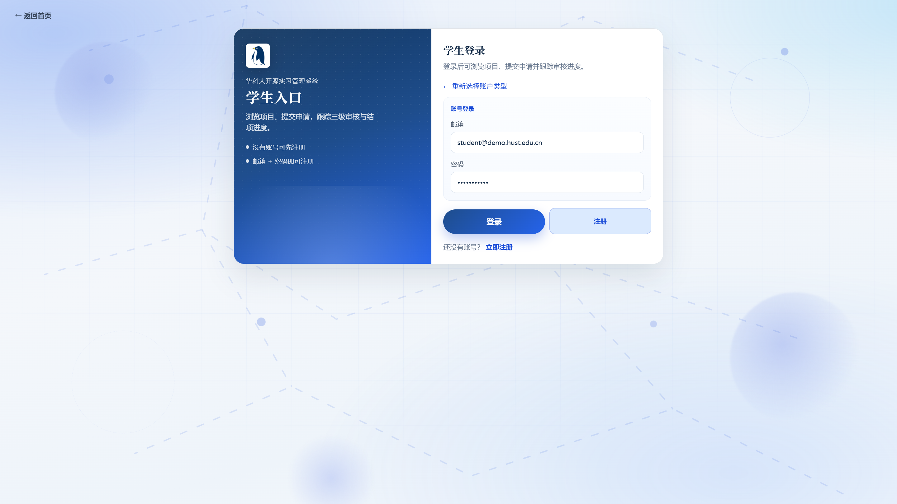
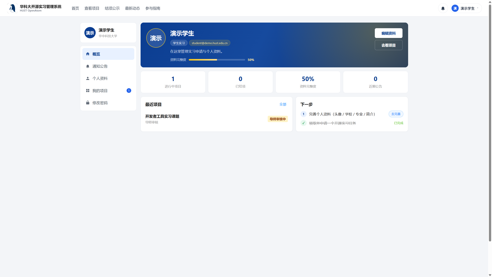
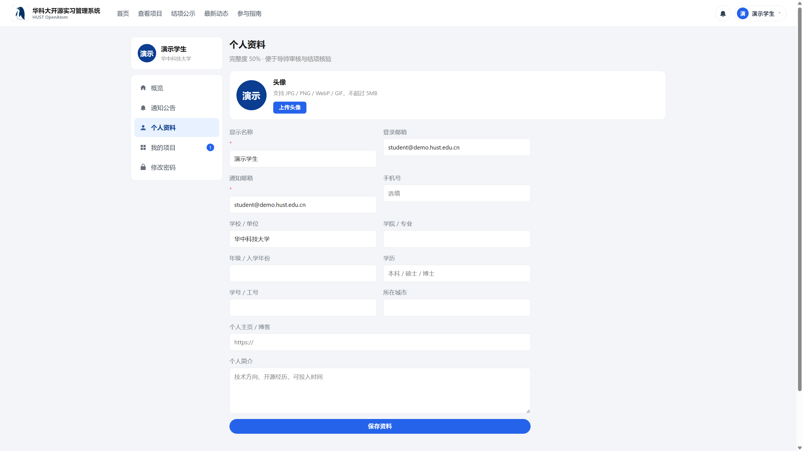
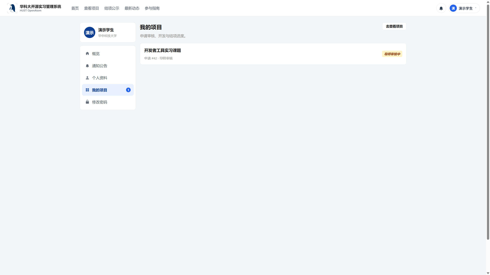
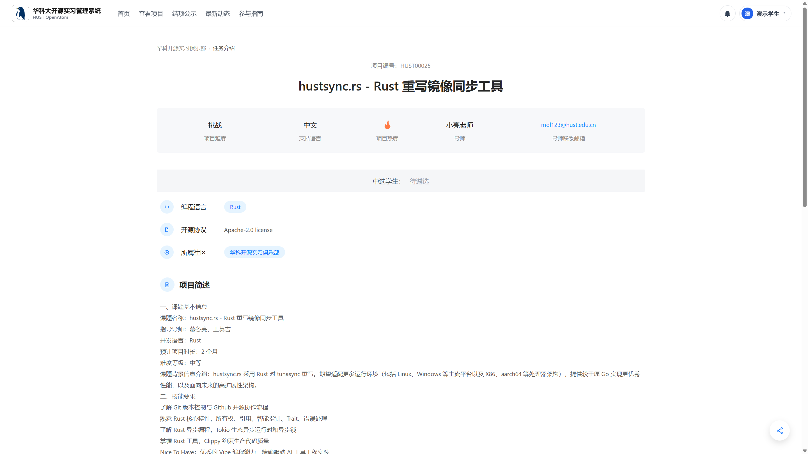
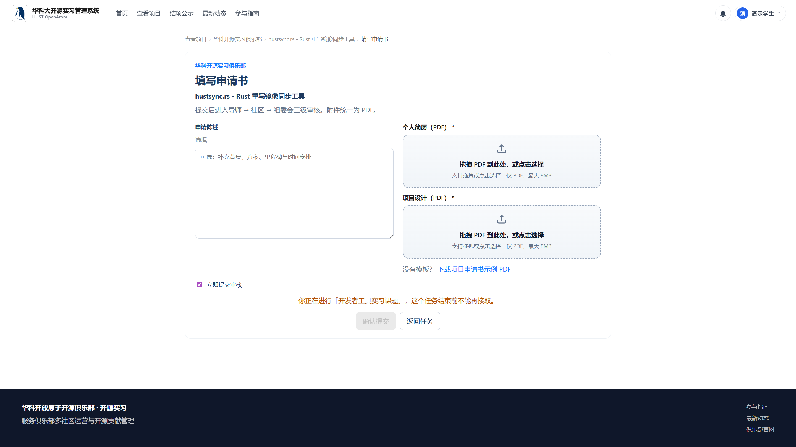
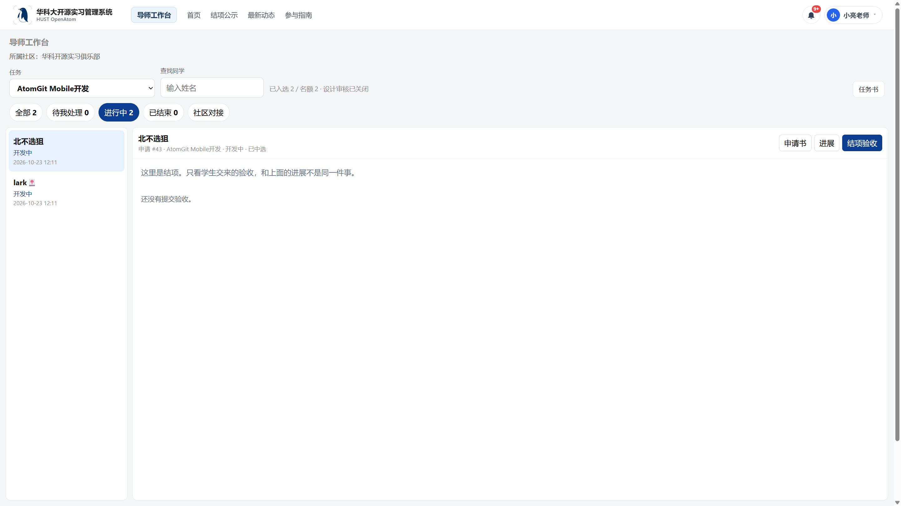
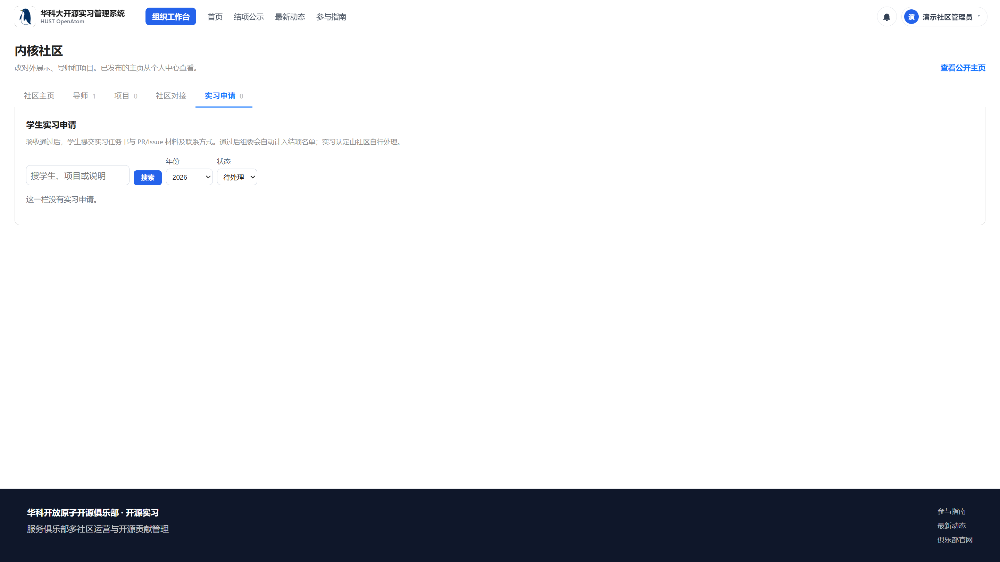

# 学生端 · 操作手册

## 适用对象

参加开源实习的**在校学生**：浏览课题、提交申请、跟进三级审核、开发更新进展、提交结项验收、向**所属社区**申请实习认定。

## 入口地址

| 用途 | 地址 |
| --- | --- |
| 注册 | https://intern.openatom.club/register |
| 登录（选「学生」） | https://intern.openatom.club/login?role=student |
| 个人中心 | https://intern.openatom.club/me |
| 查看项目 | https://intern.openatom.club/projects |
| 我的项目列表 | https://intern.openatom.club/projects?tab=mine |

## 前置条件

1. 有效邮箱，能收到通知（建议与 Git 提交邮箱一致，便于结项核验）。  
2. 同时只能有一个**未结束**的任务申请（进行中不能接取其他课题）。  
3. 申请需准备 **PDF**：个人简历、项目设计/申请书。  
4. 结项与进展需按页面要求上传 **ZIP** 等材料。  
5. **实习认定 ZIP** 提交给**项目所属社区的组织账号**，不是组委会。

本地演示账号与密码见 `docs/测试账号.md`（勿写入生产文档）。

---

## 全流程概览

```text
注册/登录 → 完善个人资料 → 浏览课题 → 填写申请书（PDF）
    → 导师审核 → 社区确认 → 组委会确认（三级，导师通过后即可开发）
    → 更新进展 → 提交结项验收 → 导师验收
    → 向社区「申请实习」（任务书 ZIP）→ 社区审核 → 组委会计入结项名单/公示
```

---

## 1. 注册学生账号

1. 打开 https://intern.openatom.club/register 。  
2. 填写 **邮箱**、**密码**（至少 6 位）、**显示名称**、**学校**（可选）。  
3. 点击 **注册并登录**。  
4. 成功后进入 **个人中心**（`/me`）。


**预期结果**：自动登录，左侧导航可见「概览」「通知公告」「个人资料」「我的项目」「修改密码」。

---

## 2. 登录（已注册）

1. 打开 https://intern.openatom.club/login ，选择 **学生**。  
2. 输入邮箱、密码，点击 **登录**。  
3. 若从课题页跳转而来，登录后会回到原页面。



**预期结果**：进入 `/me` 或登录前访问的页面。

---

## 3. 个人中心概览

1. 登录后点击右上角头像或访问 `/me` 。  
2. 左侧 **概览**：查看进行中项目数、资料完整度提示。  
3. 按提示完善头像、学校、专业等信息（便于导师审核）。  
4. 可从概览快捷进入 **我的项目** 或 **个人资料**。



**预期结果**：看到统计与待办提示；完整度提高后审核更顺畅。

---

## 4. 完善个人资料

1. 在个人中心点击 **个人资料**。  
2. 填写/修改：显示名称、学校、专业、简介、代码托管链接等（以表单字段为准）。  
3. 保存后返回 **概览** 查看完整度变化。



**预期结果**：资料保存成功；导师在审核申请时可看到更新后的信息。

---

## 5. 浏览并选择课题

1. 顶部导航进入 **查看项目**。  
2. 在 **社区列表** 了解各社区方向；在 **全部任务** 按难度、方向筛选。  
3. 点击 **查看** 进入任务详情，阅读 Markdown 任务书、导师与名额信息。  
4. 确认无其他进行中的任务且名额未满后，点击 **申请接取**。



**预期结果**：进入详情页或申请书填写页。

---

## 6. 查看任务详情并发起申请

1. 在详情页核对：难度、技术栈、仓库链接、所属社区。  
2. 点击 **申请接取**（未登录会先跳转学生登录）。  
3. 若提示「正在进行另一个任务」，需先结束或放弃原任务后再申请。



**预期结果**：进入「填写申请书」页。

---

## 7. 填写并提交申请书

1. 在 **填写申请书** 页确认课题标题与社区名称。  
2. **申请陈述**（选填）：背景、方案、里程碑与时间安排。  
3. 上传 **个人简历（PDF）**、**项目设计（PDF）**（必填；可下载页内「项目申请书示例 PDF」参考）。  
4. 勾选 **立即提交审核**（默认建议勾选；不勾选则保存为草稿，需在「我的项目」中再提交）。  
5. 点击提交。



**预期结果**：提示「申请提交成功」，跳转到该任务的 **我的项目** 详情（`?tab=task`）。

---

## 8. 跟踪申请与三级审核

1. 入口任选其一：  
   - 个人中心 → **我的项目**；  
   - **查看项目** → **我的项目** Tab；  
   - 任务详情页 **进入我的项目**。  
2. 打开具体申请，左侧子导航：**任务指南**、**任务动态**、**结果公示**、**我的项目**（主操作在最后一项）。  
3. 在 **我的项目** 查看阶段条：**申请审核** → **任务开发** → **结项验收**。  
4. 申请阶段显示 **导师 → 社区 → 组委会**；导师通过并预留名额后，社区与组委会确认**并行**，不阻断开发。


### 申请/任务状态说明（列表与详情）

| 状态文案 | 含义 | 你可做的操作 |
| --- | --- | --- |
| 导师审核中 | 等待导师看设计/简历 | 等待；可看审核意见 |
| 导师已通过 · 名额已预留 | 导师通过，社区/组委会确认中 | 可开始 **更新进展** |
| 未通过 | 导师或后续节点驳回 | 名额有空时可 **再次申请** |
| 已放弃/取消 | 你主动放弃 | 名额有空时可重新申请 |
| 开发中 | 正式开发期 | 更新进展、准备结项 |
| 结项已提交 / 导师结项审核中 | 验收材料在审 | 等待；审核中不可重复提交验收 |
| 验收已通过 · 可申请实习 | 导师结项通过 | **申请实习**（ZIP 交社区） |
| 组委会已接收结项 | 社区通过实习申请后系统自动计入 | 关注公示 |
| 结项未通过 | 验收被退回 | 按意见修改后 **再次提交验收** |
| 已结项 | 流程结束 | 查看公示与通知 |

---

## 9. 任务开发：更新进展

1. 导师通过并预留名额后，在申请详情 **我的项目** 点击 **更新进展**。  
2. 填写进展说明、设计文档链接、代码仓链接（不涉及可填「暂无」）。  
3. 上传 **交付件（ZIP）**。  
4. 阅读并同意 **《任务进展提交协议》**，提交。  
5. 可多次更新；进展**不等于**结项验收，不会直接通过/驳回验收。


> 上图为导师工作台「进展」页示意：你提交后，导师在此查看并留言；学生侧入口在申请详情的 **更新进展**。

**预期结果**：返回申请详情；导师在工作台「进展」页能看到并留言建议。

---

## 10. 提交结项验收

1. 在开发阶段点击 **提交验收**（验收审核进行中时按钮不可用）。  
2. 填写结项说明、设计文档/报告链接、PR/MR 或代码链接。  
3. 上传 **交付件（ZIP）**。  
4. 同意 **《验收材料提交协议》** 后确认提交。  
5. 等待 **导师结项审核**；通过后状态变为可申请实习。



> 上图为导师工作台「结项验收」页示意：你提交 ZIP 后导师在此审核；学生侧入口在申请详情的 **提交验收**。

**预期结果**：状态进入「导师结项审核中」；通过后显示「验收已通过 · 可申请实习」。

---

## 11. 向社区申请实习（ZIP）

> **重要**：材料提交给**本项目所属社区**的组织管理员（组织工作台 → **实习申请**），**不要**发给组委会。

1. 导师验收通过后，在申请详情点击 **申请实习**（或 **重新申请实习** 若被社区驳回）。  
2. 下载 **实习任务书模板.docx**，填写后与 PR/Issue 等材料打成 **ZIP**。  
3. 填写至少一项联系方式（手机/邮箱/其他）。  
4. 上传 ZIP，同意 **《实习申请协议》**，提交。  
5. 社区在组织端审核；**通过后组委会自动计入结项名单**，实习认定由社区自行处理。



> 上图为组织工作台「实习申请」列表示意：学生提交后，社区管理员在此审核。

**预期结果**：显示「已经提交过实习申请」或「实习申请审核中/已通过」；组委会侧结项名单随后台流程更新。

---

## 12. 通知与密码

1. **通知公告**：个人中心查看站内通知（审核结果、对接消息等）。  
2. **修改密码**：左侧 **修改密码**，输入旧密码与新密码后 **确认修改密码**。

---

## 操作清单（学生）

- [ ] 注册并登录学生账号  
- [ ] 个人资料完整度达标  
- [ ] 阅读任务书后提交 PDF 申请书  
- [ ] 关注三级审核与导师意见  
- [ ] 导师通过后定期 **更新进展**  
- [ ] 完成开发后 **提交验收**  
- [ ] 验收通过后向 **所属社区** 提交实习 ZIP  
- [ ] 查看结项公示与通知  

---

## 常见问题

**Q：登录选成导师/组织怎么办？**  
A：退出登录，重新打开 `/login`，点「← 重新选择账户类型」后选 **学生**。

**Q：为什么不能接第二个项目？**  
A：平台限制同时仅一个未结束任务；需完成、放弃或被驳回且无其他进行中任务后再申请。

**Q：导师通过后还要等社区/组委会才能写代码吗？**  
A：导师通过并预留名额后即可 **更新进展** 与开发；社区/组委会确认为并行节点。

**Q：实习 ZIP 交给谁？**  
A：仅交给 **项目所属社区**（组织工作台「实习申请」），不是组委会。

**Q：演示密码在哪里？**  
A：`docs/测试账号.md`，仅限本地/演示环境。
