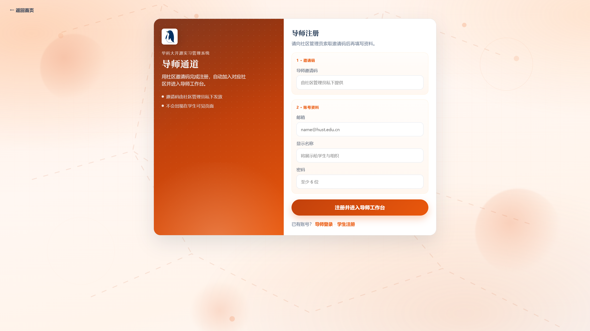
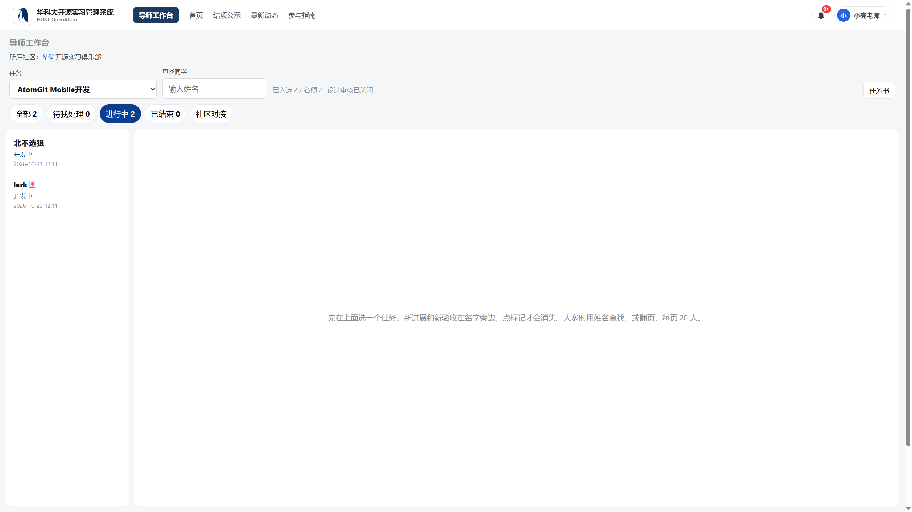
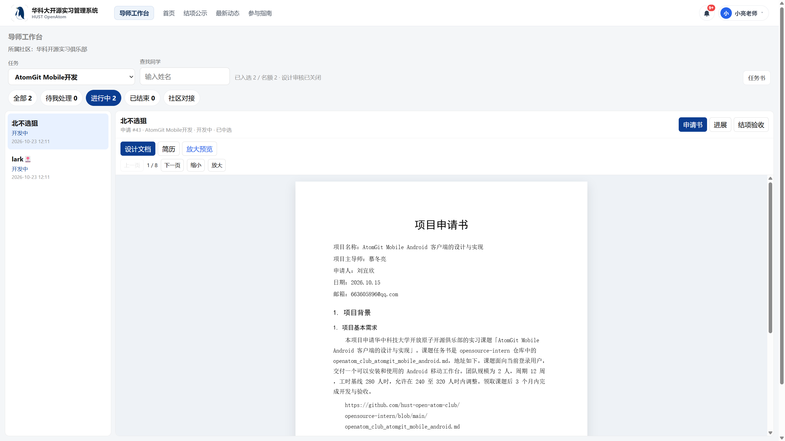
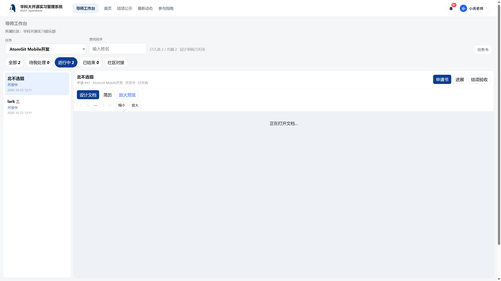
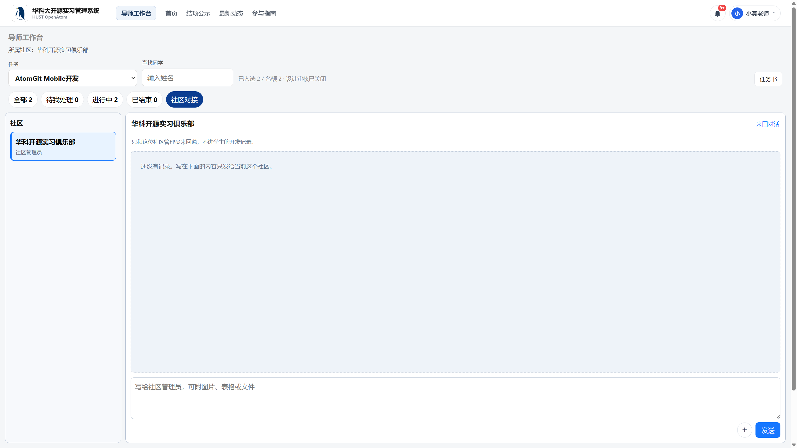
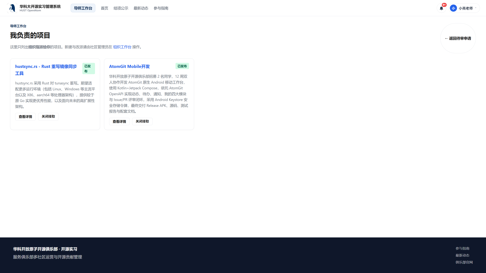

# 导师端 · 操作手册

## 适用对象

负责指导学生的**社区导师**：审核申请书与设计、跟进进展、结项验收，并与社区管理员沟通。

## 入口地址

| 用途 | 地址 |
| --- | --- |
| 邀请码注册 | https://intern.openatom.club/register/mentor |
| 登录（选「导师」） | https://intern.openatom.club/login?role=mentor |
| 导师工作台 | https://intern.openatom.club/mentor |
| 我负责的项目 | https://intern.openatom.club/mentor/projects |

## 前置条件

1. 向**所属社区管理员**索取 **导师邀请码**（组织工作台 → **导师** 页查看/复制；勿公开给学生）。  
2. 使用邀请码完成 **导师注册**，自动绑定该社区。  
3. **课题由组织创建并指定你为负责导师** 后，任务才会出现在工作台「任务」下拉框中。  
4. 导师 **不能** 自行新建社区课题；新建、改派、下架由组织在 `/org` 操作。

演示账号见 `docs/测试账号.md`（仅本地/演示）。

---

## 全流程概览

```text
邀请码注册 → 导师登录 → 组织创建项目并指派你
    → 工作台审核申请（设计/简历）→ 通过后学生进入开发
    → 查看进展并留言建议 → 结项验收（通过/退回）
    → 学生向社区提交实习材料 → 社区审核 → 组委会计入结项名单
```

你在申请链路上承担 **第一级（导师）** 与 **结项第一审**；社区、组委会节点由系统与其他角色处理。

---

## 1. 邀请码注册

1. 向社区管理员获取邀请码（组织端 **导师** Tab → **显示** → **复制**）。  
2. 打开 https://intern.openatom.club/register/mentor 。  
3. **1 · 邀请码**：填写导师邀请码（不区分大小写）。  
4. **2 · 账号资料**：邮箱、显示名称、密码（至少 6 位）。  
5. 点击 **注册并进入导师工作台**。



**预期结果**：进入 `/mentor`；页头显示「所属社区：xxx」。

---

## 2. 导师登录

1. 打开 `/login`，选择 **导师**。  
2. 输入邮箱、密码，**登录**。  
3. 纯导师账号默认进入 **导师工作台**（非 `/me` 学生中心）。


**预期结果**：看到「导师工作台」标题与任务选择器。

---

## 3. 认识导师工作台布局

1. 页头 **任务** 下拉：选择组织指派给你的课题；**已停招但仍有在途学生**的课题也会保留。无课题时显示「暂无负责项目」空态，可进「社区对接」或导师指南。  
2. **查找同学**：按姓名筛选当前任务下的学生。  
3. 筛选 Tab：**全部** / **待我处理** / **进行中** / **已结束** / **社区对接**。  
4. 右侧 **任务书**、**导师指南** 链接。切换学生时右侧会先清空再加载，避免串材料。



**预期结果**：选好任务后，下方列表显示该课题下的学生申请。

---

## 4. 处理「待我处理」申请

1. 点击筛选 **待我处理**（含待看设计、待验收等）。  
2. 名单旁 **新进展** / **新验收** 标记：点击学生行进入详情后标记才会清除。  
3. 点击某学生，右侧打开详情。  
4. 子 Tab：**申请书** / **进展** / **结项验收**（不同阶段默认打开不同 Tab）。



### 名单上的简要标签（导师视角）

| 标签 | 含义 |
| --- | --- |
| 待看设计 | 学生已提交申请，等你审 PDF |
| 人选已满 | 名额已满，不能再通过新申请 |
| 待验收 | 学生已提交结项材料 |
| 已打回，等再交设计/验收 | 你曾退回，等学生修改 |
| 开发中 | 已通过申请，日常跟进 |
| 验收已通过 | 结项你已通过，学生可走实习申请 |

---

## 5. 审核申请书（第一级）

1. 在学生详情选择 **申请书**。  
2. 切换 **设计文档** / **简历** 预览 PDF。  
3. 若名额未满且状态为待审：  
   - 填写 **审核意见**（退回时必填）；  
   - 点击 **通过** 或 **退回**（确认对话框）。  
4. 通过后系统预留名额；学生可开始开发，社区/组委会节点并行确认。



**预期结果**：通过 → 学生侧显示「导师已通过 · 名额已预留」；退回 → 学生看到意见并可按规定再次申请。

---

## 6. 跟进进展

1. 选择 **进展** Tab。  
2. 查看学生最新 ZIP、链接与历史进展。  
3. 在 **给这次进展的建议** 中留言，点击发送。  
4. **注意**：此处只能给建议，**不能** 在此通过/退回结项验收。

**预期结果**：学生能在申请详情中看到导师留言；结项状态不变。

---

## 7. 结项验收

1. 学生提交验收后，在 **结项验收** Tab 查看材料。  
2. 阅读验收说明与附件。  
3. **结项通过**：可不填意见；**退回**：必须在意见中写明修改要求。  
4. 点击 **结项通过** 或相应退回按钮并确认。  
5. 通过后学生状态为「验收已通过 · 可申请实习」；学生向 **社区** 交实习 ZIP，不是交给你或组委会。

**预期结果**：结项通过 → 学生可申请实习；退回 → 学生修改后再次提交验收。

---

## 8. 社区对接

1. 筛选 Tab 选 **社区对接**。  
2. 左侧选择所属 **社区**（社区管理员）。  
3. 在对话区与组织沟通课题、名额、流程等问题（**不会** 进入学生开发记录）。



**预期结果**：消息仅社区管理员可见；用于内部协调。

---

## 9. 我负责的项目（只读列表）

1. 从个人中心侧栏 **导师工作台** 或访问 `/mentor/projects` 。  
2. 查看组织指派给你的项目列表、状态（已发布 / 已下架等）。  
3. 可对已发布项目执行 **关闭接取**（不能再新申请，详情仍可见）；**不能** 在此新建项目。



**预期结果**：列表与组织端「项目」一致；改派需联系社区管理员。

---

## 操作清单（导师）

- [ ] 使用正确社区的邀请码完成注册  
- [ ] 确认组织已创建项目并指定你为负责导师  
- [ ] 及时处理「待我处理」中的设计与结项  
- [ ] 开发期定期查看进展并留言  
- [ ] 结项验收意见清晰，退回时写明修改点  
- [ ] 通过「社区对接」与组织保持沟通  
- [ ] 不尝试自行创建课题（应联系组织）  

---

## 常见问题

**Q：工作台「任务」下拉为空？**  
A：组织尚未在 **组织工作台 → 项目** 创建并发布项目，或未把你选为 **负责导师**。

**Q：为什么不能通过某份申请？**  
A：可能名额已满（「设计审核已关闭」），或该生不在待审状态。

**Q：学生实习材料我要审吗？**  
A：实习 ZIP 由 **社区管理员** 在组织端「实习申请」审核；你负责结项验收即可。

**Q：能否改任务书内容？**  
A：不能。请社区管理员在组织端编辑；已有学生结项的项目可能限制修改。

**Q：演示账号？**  
A：见 `docs/测试账号.md`。
