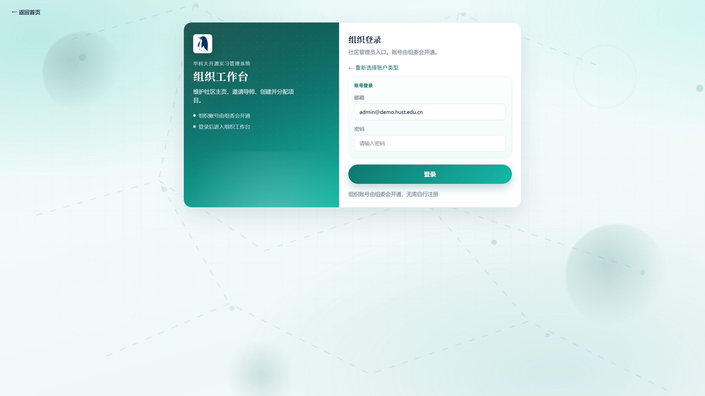
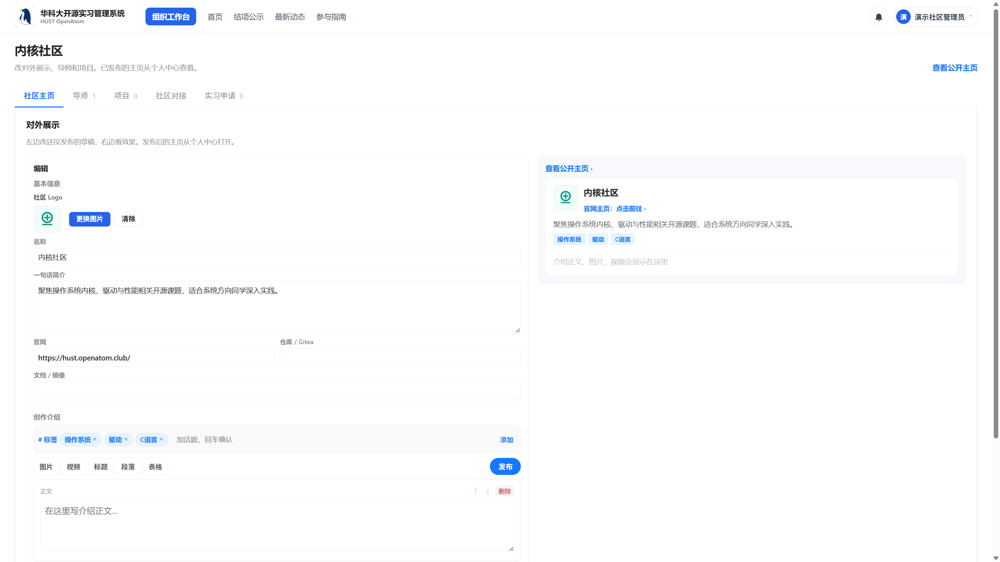
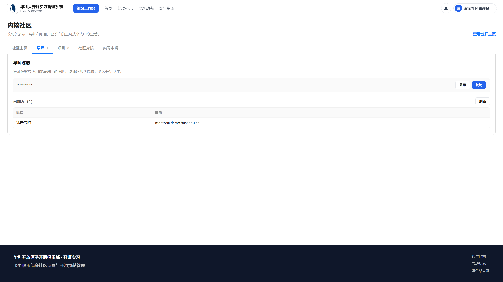
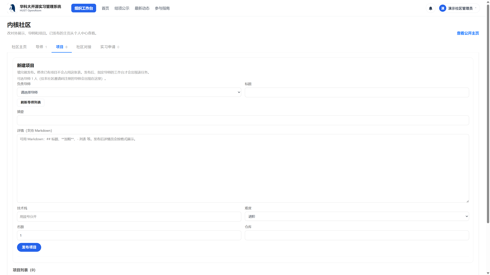
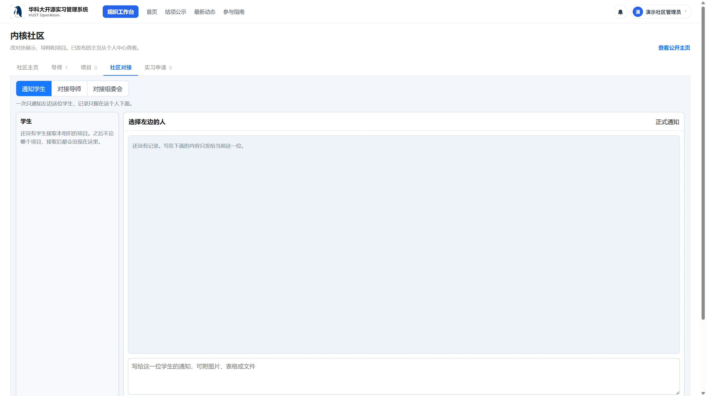
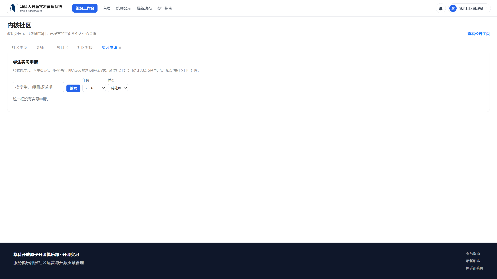

# 组织端（社区管理员）· 操作手册

## 适用对象

已通过组委会准入的**开源社区管理员**：维护社区公开主页、邀请导师、创建/发布/下架项目、社区级审核与实习材料处理、与导师/组委会对接。

## 入口地址

| 用途 | 地址 |
| --- | --- |
| 登录（选「组织」） | https://intern.openatom.club/login?role=org |
| 组织工作台 | https://intern.openatom.club/org |
| 组织个人中心 | https://intern.openatom.club/me |

## 前置条件

1. **组织账号由组委会开通**（`/ops/login` → **账号** → 创建组织）；不能自助注册。  
2. 登录邮箱与初始密码由组委会发放；可在个人中心 **修改密码**。  
3. 至少一名导师用本社区 **邀请码** 注册后，才能创建项目并选择 **负责导师**。  
4. 项目 **详情支持 Markdown**；点 **保存并发布** 会先保存当前编辑再上线。  

演示账号见 `docs/测试账号.md`（仅本地/演示）。

---

## 全流程概览

```text
组委会开通社区与组织账号 → 你发布社区主页 → 发放导师邀请码
    → 创建项目并指定导师 → 学生申请 → 你配合社区节点审核
    → 导师验收后学生提交实习 ZIP → 你在「结项后实习审核」审核
    → 通过后组委会自动计入结项名单
```

组织端顶部分区（默认进 **项目**）：**项目** / **结项后实习审核** / **导师** / **社区对接** / **社区主页编辑**。

---

## 1. 组织登录

1. 打开 https://intern.openatom.club/login 。  
2. 选择 **组织**（社区管理员）。  
3. 输入组委会提供的 **邮箱**、**密码**，点击 **登录**。  
4. 进入 **组织工作台**（`/org`）或组织向 **个人中心**（`/me`）。



**预期结果**：工作台顶部显示本社区名称；五个 Tab 可用。

---

## 2. 组织个人中心（可选）

1. 访问 `/me`（组织账号专属概览）。  
2. 查看社区名称、导师数量等 KPI。  
3. 快捷链接：**查看公开主页**、**编辑社区主页**（`/org?tab=home`）、**管理项目**（`/org?tab=projects`）、**修改密码**。

**预期结果**：与组织工作台数据一致；对外展示以「发布到公开主页」为准。

---

## 3. 社区主页编辑与发布

1. 组织工作台 → **社区主页编辑**。  
2. 左侧 **编辑**：  
   - **基本信息**：Logo、名称、一句话简介、官网、仓库/Gitea、文档/镜像链接。  
   - **创作介绍**：正文与话题标签（图文编辑器）。  
3. 右侧 **预览** 实时查看效果；可点 **查看公开主页** 打开 `/communities/{slug}`。  
4. 确认后点击底部唯一主按钮 **发布到公开主页**（草稿未点发布时，访客仍看旧版）。



**预期结果**：公开社区页更新；学生在「社区列表」可见最新介绍。

---

## 4. 导师：邀请码与名单

1. 打开 **导师** Tab。  
2. **导师邀请** 区域：点击 **显示** 查看邀请码 → **复制**，私下发给拟加入的导师（**勿** 发给学生或公开页面）。  
3. 导师在 `/register/mentor` 用该码注册。  
4. **已加入** 表格列出姓名、邮箱；可用 **移除** 解除本社区绑定（若仍有负责项目，需先改派）。  
5. 需要时点 **刷新** 更新列表。



**预期结果**：邀请码注册的导师出现在列表；可用于新建项目时的「负责导师」下拉。

---

## 5. 项目：列表、新建与发布

1. 打开 **项目** Tab（默认落地页）：上方是 **项目列表**。  
2. 需要新建时点 **新建项目** 展开表单，填写：  
   - **负责导师**（必选；无导师时先完成上一节）  
   - **标题**、**摘要**  
   - **详情（支持 Markdown）**：任务书正文  
   - **技术栈**（逗号分隔）、**难度**（基础/进阶/挑战）、**名额**、**仓库** URL  
3. 点击 **发布项目**；发布后表单自动收起。  
4. 发布后，对应导师的 **导师工作台 → 任务** 下拉才会出现该课题；学生可在「全部任务」申请。  
5. 修改已有项目：在列表点 **修改 / 预览调整**，用 **保存修改** 或 **保存并发布**（后者会先保存再上线）。



**Markdown 示例**：

```markdown
## 一、课题简介
……

## 二、技术要求
- 项 1
- 项 2
```

**预期结果**：项目列表状态为「已发布」；公开详情页按 Markdown 渲染。

---

## 6. 项目：调整、下架与重新发布

1. 在 **项目列表** 查看状态、导师、**改派** 下拉（可更换负责导师）。  
2. **已发布** 项目：  
   - **下架**：学生不能再新申请，已有申请保留。  
   - **预览调整** / 编辑后 **保存修改**；下架项可 **重新发布**（**重新发布** 会自动保存再上线）。  
3. **已有学生结项** 的项目：系统可能禁止再改任务内容（以页面提示为准）。


### 项目状态说明

| 状态 | 含义 |
| --- | --- |
| 已发布 | 学生可见、可申请（名额未满时） |
| 已关闭接取 | 不再接新申请，详情仍可见 |
| 已下架 | 学生端不可见/不可新申请 |
| 草稿 | 未对学生公开 |

---

## 7. 社区对接

1. 打开 **社区对接** Tab。  
2. 与导师、组委会进行社区级沟通（具体界面为社区工作台组件）。  
3. 用于协调课题、审核节奏、材料要求等，**不替代** 学生在申请详情中的正式记录。



**预期结果**：消息送达对应角色；导师在导师工作台「社区对接」可回复。

---

## 8. 结项后实习审核（学生 ZIP）

> 学生结项验收通过后，将 **实习任务书 + PR/Issue 等材料 ZIP** 提交到**本社区**，不是组委会。

1. 打开 **结项后实习审核** Tab（导航角标为**全部年份待审数**）。默认年份为「全部」，避免漏看往年待办。  
2. 使用搜索、**年份**、**状态**（待处理/已通过/已驳回/全部）筛选。  
3. 打开条目：查看学生说明、下载 **实习申请材料.zip**。  
4. **通过**：组委会自动计入结项名单；实习认定由社区自行处理。  
5. **驳回**：填写 **驳回原因**，学生可重新申请。



**预期结果**：通过后学生侧显示「实习申请已通过」；组委会 **结项名单** 相应增加记录。

---

## 9. 配合三级审核（社区节点）

申请阶段：导师通过后，社区与组委会在系统中并行确认；你需关注通知与 **社区对接**，必要时在流程中处理社区侧待办（若工作台有社区审核入口，以实际页面为准）。

结项阶段：导师结项通过后，学生在平台 **申请实习**；**你在「结项后实习审核」完成社区审核**，无需向组委会传送 ZIP。

---

## 操作清单（组织）

- [ ] 使用组委会账号登录并修改初始密码  
- [ ] 发布社区公开主页  
- [ ] 复制邀请码并邀请导师注册  
- [ ] 创建项目、指定导师、发布（Markdown 任务书）  
- [ ] 按需下架/修改/重新发布项目  
- [ ] 处理 **实习申请**（学生 ZIP）  
- [ ] 通过 **社区对接** 与导师、组委会沟通  

---

## 常见问题

**Q：登录页没有组织注册？**  
A：组织账号仅组委会在运维台 **账号 → 创建** 开通。

**Q：新建项目时没有可选导师？**  
A：确认导师使用 **本社区** 邀请码注册，并在 **导师** 页 **刷新**。

**Q：修改详情后学生看不到？**  
A：需 **保存修改** 或对下架项目点 **重新发布**；学生端可 Ctrl+F5 强刷。

**Q：学生把实习材料发给了组委会怎么办？**  
A：应指引学生在申请详情 **申请实习**，材料进入组织端 **实习申请**，不由组委会收件。

**Q：演示密码？**  
A：`docs/测试账号.md`。
