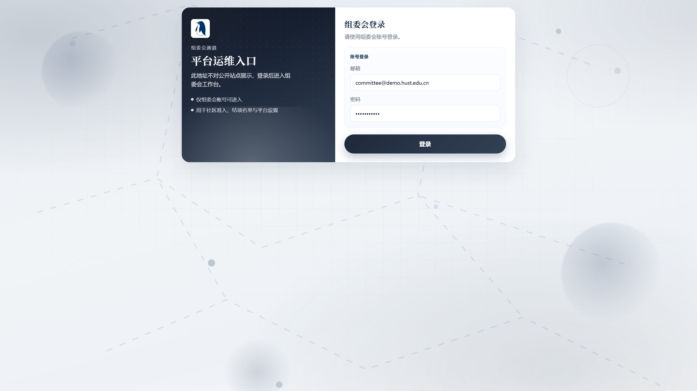
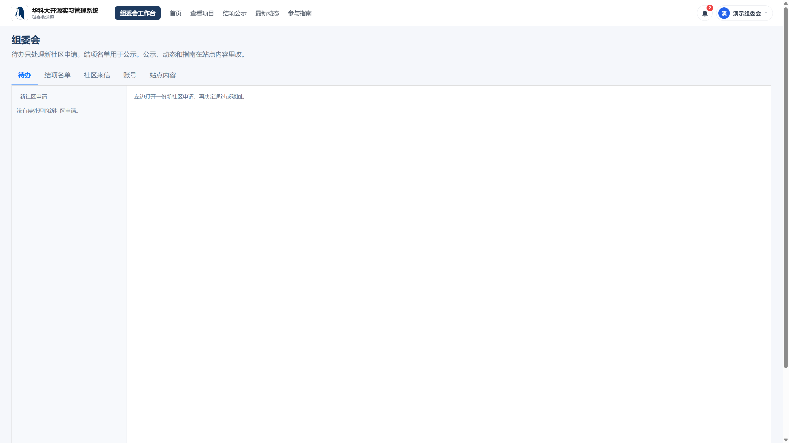
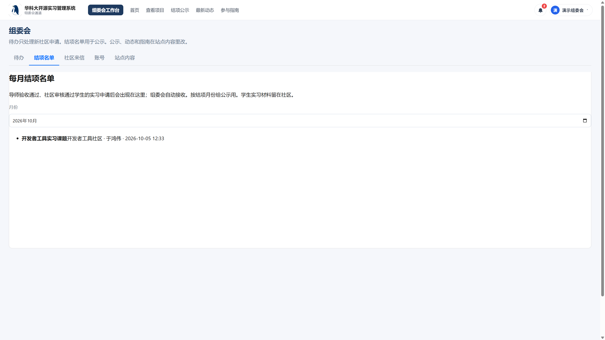
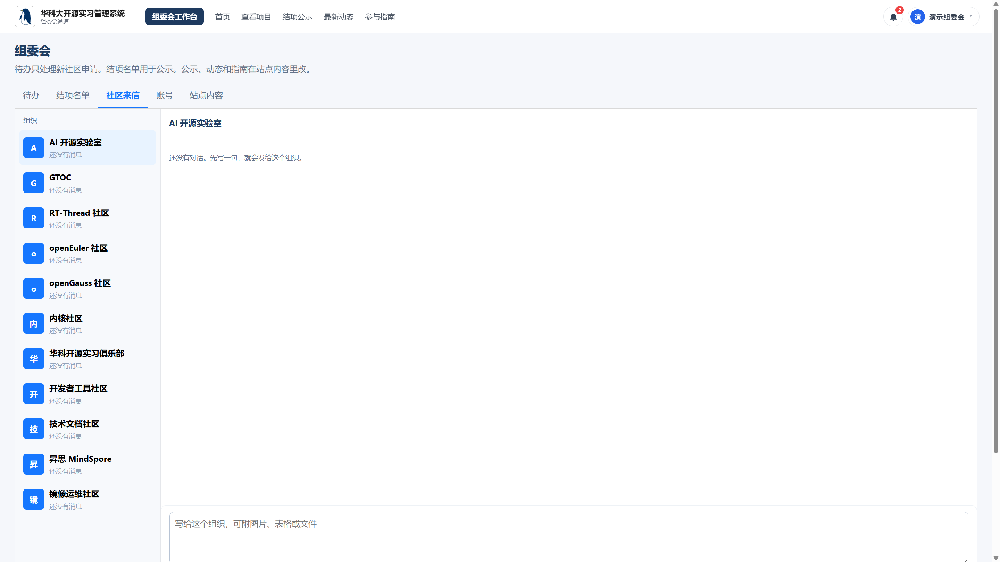
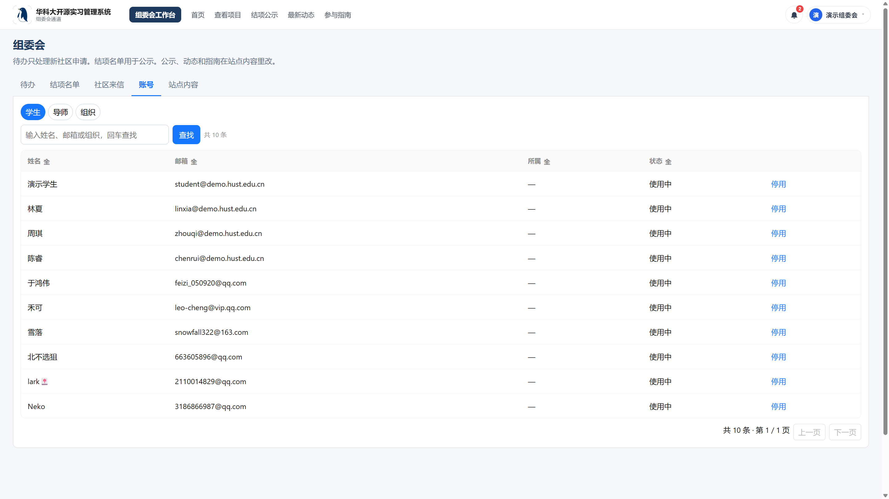
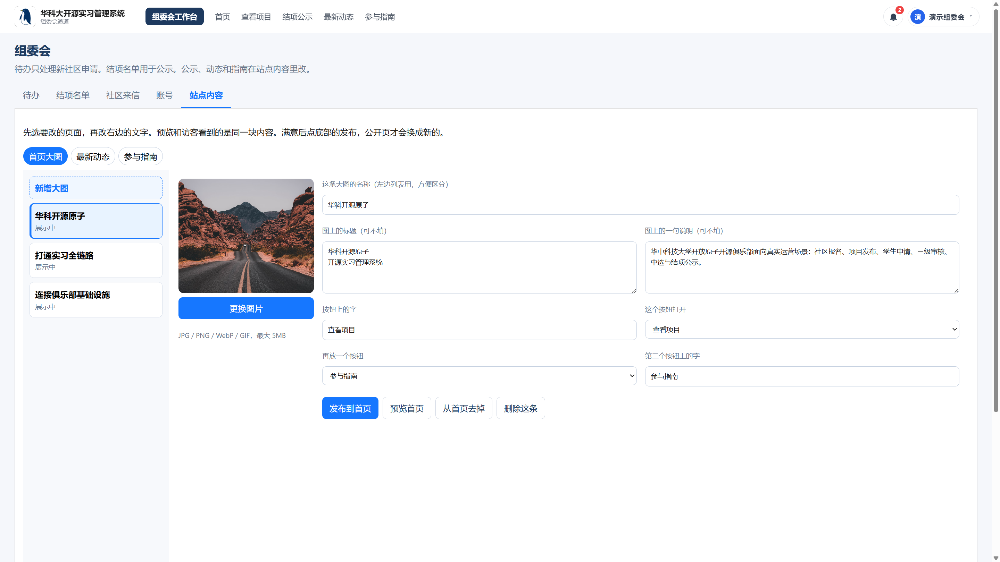

# 组委会端 · 操作手册

## 适用对象

华中科技大学开放原子开源俱乐部 **组委会运维人员**：社区准入、组织账号开通、结项名单与公示、站点内容、社区来信、账号管理。

## 入口地址

| 用途 | 地址 |
| --- | --- |
| 组委会登录 | https://intern.openatom.club/ops/login |
| 组委会工作台 | https://intern.openatom.club/committee |

> **注意**：组委会入口 **不在** 公开导航与学生/导师/组织登录页的身份列表中；请收藏 `/ops/login`。

## 前置条件

1. 组委会账号由平台管理员预先开通（仅 **组委会权限** 的账号可登录运维入口）。  
2. 了解业务分工：**待办** 处理新社区申请；**结项名单** 汇总公示数据；**实习 ZIP** 由社区审核，组委会 **不代收** 学生实习材料。  
3. 公开页的动态、指南、结项公示文案在 **站点内容** 维护。

演示账号见 `docs/测试账号.md`（仅本地/演示，勿用于生产）。

---

## 全流程概览

```text
新社区申请（待办）→ 通过并开通组织账号
    → 社区/导师/学生按平台正常运营
    → 导师验收 + 社区通过实习申请 → 结项名单自动汇总
    → 站点内容发布结项公示 / 动态 / 指南
    → 账号 Tab 管理学生/导师/组织状态
```

工作台 Tab：**待办** / **结项名单** / **社区来信** / **账号** / **站点内容**。

---

## 1. 组委会登录

1. 打开 https://intern.openatom.club/ops/login（勿使用 `/login` 身份选择页）。  
2. 输入组委会 **邮箱**、**密码**。  
3. 点击登录，进入 **组委会** 工作台（`/committee`）。  
4. 若提示「该账号无组委会权限」，联系管理员核对账号角色。



**预期结果**：看到标题「组委会」及五个 Tab。

---

## 2. 待办：新社区申请

1. 打开 **待办** Tab。  
2. 左侧列表 **新社区申请**，点击一条申请。  
3. 右侧查看：社区名称、slug、简介、官网、申请人姓名与邮箱。  
4. **审核意见**：驳回时 **必填** 原因；通过可不写。  
5. 点击 **通过** 或 **驳回**。  
6. 通过后通常伴随组织账号开通流程（与 **账号 → 创建** 配合，以系统实际动作为准）。



**预期结果**：待办列表减少；通过的社区可在公开端与账号列表中出现。

---

## 3. 结项名单

1. 打开 **结项名单** Tab。  
2. 页头说明：导师验收通过且 **社区审核通过学生实习申请** 后，记录会出现在此；**按结项月份** 供公示使用；**实习材料留在社区**。  
3. 选择 **月份**（type=month），列表刷新。  
4. 核对：项目名称、社区、学生、结项时间等字段。



**预期结果**：选定月份下有数据则列出条目；无数据时提示「这个月还没有结项」并可能提示其他已有月份。

---

## 4. 社区来信

1. 打开 **社区来信** Tab。  
2. 左侧 **组织** 列表，点击一个社区。  
3. 右侧查看对话历史，在底部输入框发送消息（可附图片、表格或文件，以组件能力为准）。  
4. 用于与社区管理员运维沟通，**不** 替代学生申请详情中的审核记录。



**预期结果**：消息出现在线程中；社区侧在组织工作台「社区对接」可回复。

---

## 5. 账号管理

1. 打开 **账号** Tab。  
2. 切换子类：**学生** / **导师** / **组织**。  
3. 搜索框输入姓名、邮箱或组织，**查找**；可用表头下拉筛选。  
4. **学生/导师**：**停用** / **恢复** 账号。  
5. **组织**：  
   - **创建**：开通新社区及组织登录账号（生成 **一次性随机初始密码**，务必复制交给对方；学生入口选「组织」登录）。  
   - **查看密码**、**停用** / **恢复**、**停止报名**（移出公开列表，需确认组织全名）。  
6. 创建组织时可查看 **导师邀请码** 等信息（交给社区管理员发导师）。



**预期结果**：列表与操作成功提示；组织创建后社区管理员可登录 `/org`。

---

## 6. 站点内容

1. 打开 **站点内容** Tab。  
2. 维护面向公众的内容（具体分区以页面为准），通常包括：  
   - **首页轮播**（标题、链接、配图等）  
   - **最新动态** / 公告发布  
   - **结项公示** 草稿与发布（类型为「结项公示」时，确定后会出现在 **最新动态** 并进入 **结项公示** 页）  
   - **参与指南** 等站点文案  
3. 编辑后按页内按钮 **保存**、**发布到结项公示** 或 **发布到动态**（以按钮文案为准）。  
4. 公开导航「首页 / 查看项目 / 结项公示 / 最新动态 / 参与指南」对应前台路由。



**预期结果**：前台 `/`、`/news`、`/completed`、`/guide` 等展示更新内容。

---

## 角色边界（组委会必读）

| 事项 | 组委会 | 社区组织 |
| --- | --- | --- |
| 开通组织账号 | ✓ | — |
| 创建/发布项目 | — | ✓ |
| 学生实习 ZIP | **不接收** | ✓ 实习申请 Tab |
| 导师邀请码 | 创建组织时可获知 | ✓ 发给导师 |
| 结项名单数据来源 | ✓ 查看与公示 | 审核实习申请触发计入 |
| 三级审核 | 终审/自动节点 | 社区节点 |

---

## 操作清单（组委会）

- [ ] 使用 `/ops/login` 登录并确认权限  
- [ ] 处理 **待办** 中的新社区申请  
- [ ] 在 **账号** 创建/维护组织与学生、导师状态  
- [ ] 按月核对 **结项名单** 并经由 **站点内容** 发布公示  
- [ ] 维护动态、指南、轮播等 **站点内容**  
- [ ] 通过 **社区来信** 与社区沟通  
- [ ] 不代替社区接收学生实习 ZIP  

---

## 常见问题

**Q：和学生/导师共用的 `/login` 有何区别？**  
A：组委会必须用 `/ops/login`；普通登录页选学生/导师/组织，且组委会账号不能从学生入口登录。

**Q：结项名单为空？**  
A：确认该月是否有「导师验收 + 社区通过实习申请」的完整链路；材料仅社区审核，不会上传到组委会。

**Q：如何给社区初始密码？**  
A：**账号 → 组织 → 创建** 后复制一次性密码；遗失可用 **查看密码**（若系统仍保留）或重置流程（以页面为准）。

**Q：演示环境账号？**  
A：`docs/测试账号.md`，仅限本地/演示。
